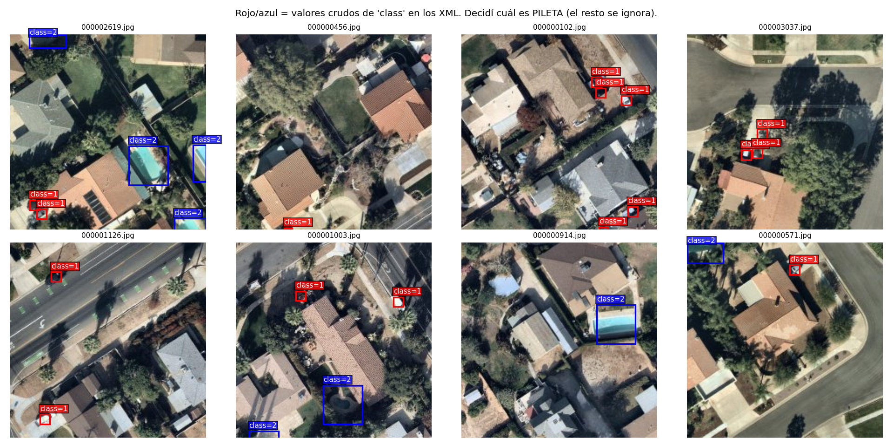
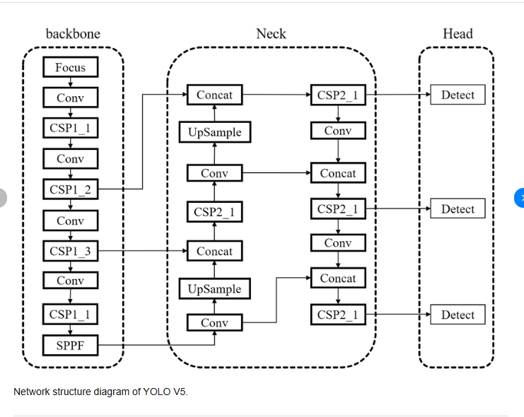
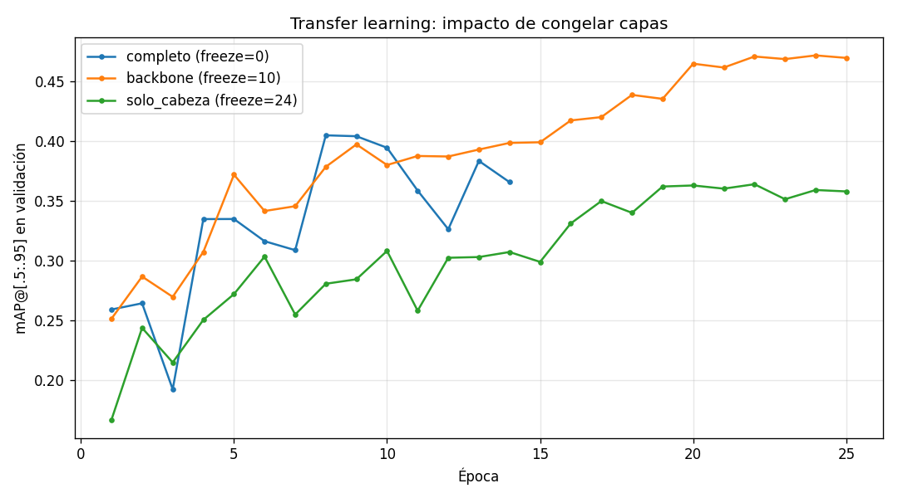
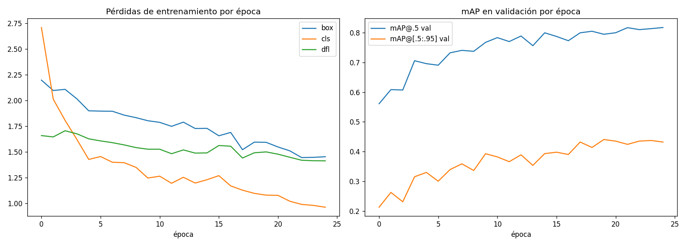
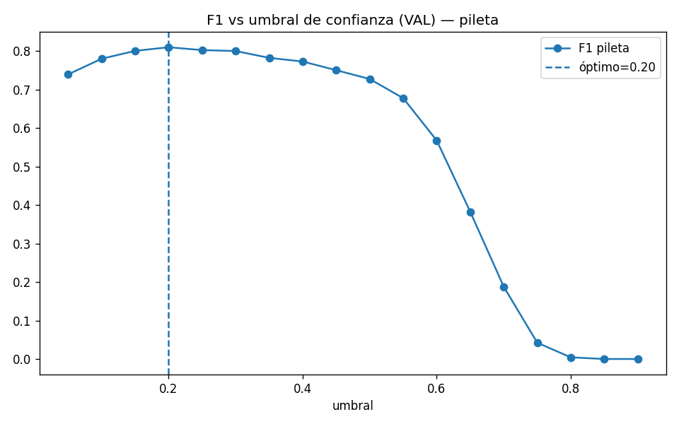
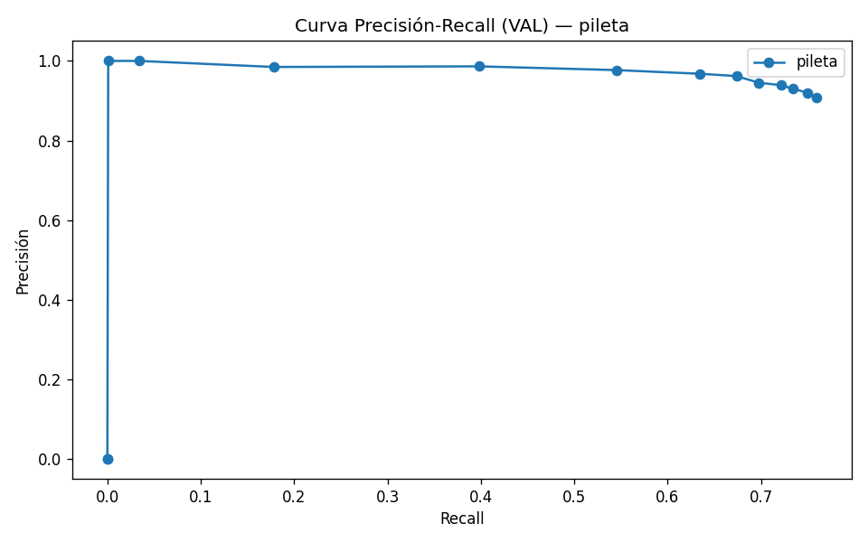
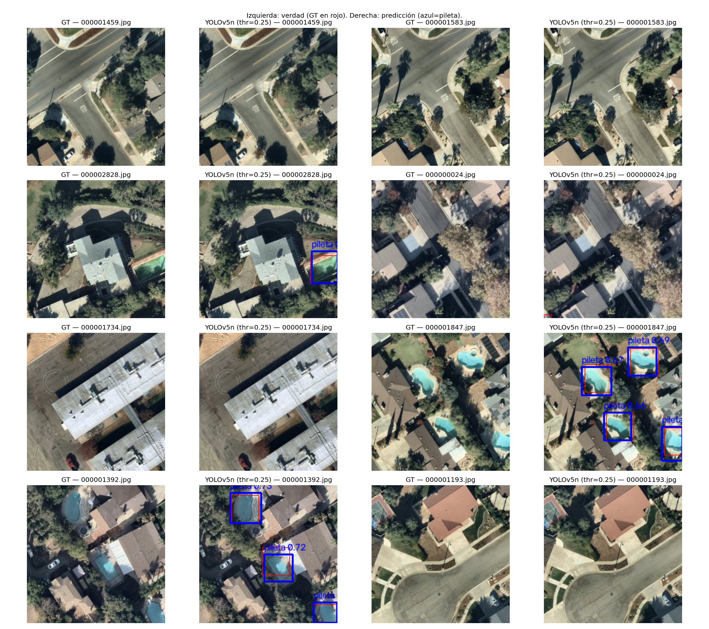
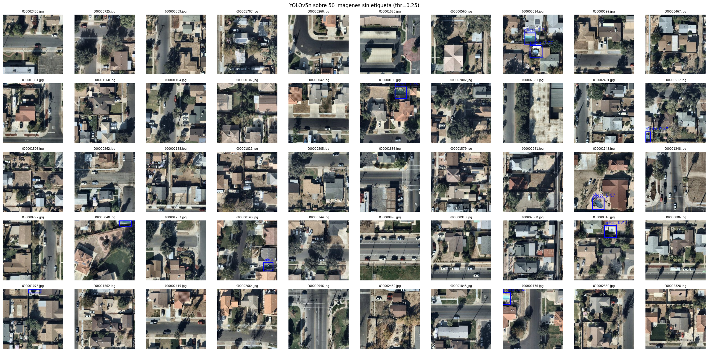

# Detección de piletas en imágenes satelitales con YOLOv5n

### Transfer learning, métricas de detección y análisis crítico de resultados

**Maestría en Inteligencia Artificial — Universidad de Palermo** · Electiva: Visión por Computadora · Trabajo Práctico Final

---

## 1. Resumen ejecutivo

Se entrenó un detector de objetos de **una sola clase** (`pileta`) sobre imágenes satelitales, partiendo de pesos pre-entrenados en COCO y aplicando *fine-tuning* completo. El modelo elegido fue **YOLOv5n** (variante *nano*, 2.64 M parámetros), el más chico de la familia y el único que permite entrenar e inferir con holgura en el tier gratuito de Google Colab.

**Resultado principal:** mAP@0.5 = **0.7620** y F1 = **0.7986** en test, con 11.75 ms por imagen en GPU (85.1 FPS) y 5.48 MB de peso en disco.

**Dos conclusiones centrales, ambas medidas:**

1. **El modelo clasifica bien pero localiza con imprecisión.** La brecha entre mAP@0.5 (0.76) y mAP@0.75 (0.36) se explica principalmente por haber entrenado a 320 px de resolución.
2. **Congelar el *backbone* resultó mejor que el *fine-tuning* completo**, al contrario de lo que este trabajo había supuesto. El experimento comparativo (§5.6) mide **+16.6 % de mAP@[.5:.95]** con `freeze=10` frente a `freeze=0`, además de un 18 % menos de tiempo por época y un 21 % menos de memoria. La hipótesis de partida quedó **refutada por los datos propios**.

El informe documenta además **cuatro defectos metodológicos** detectados al auditar el pipeline (§10). Los tres primeros están corregidos **y reejecutados**: esta versión reporta métricas del pipeline corregido, con split 70/15/15 real, barrido de umbrales completo y comparación `.pt` vs. `.onnx` válida. El cuarto se detectó al validar esta misma corrida y afectaba a la matriz de confusión del informe anterior.

## 2. El problema y los datos

### 2.1 Planteo

La tarea es **detección de objetos supervisada**: dada una imagen aérea, devolver las coordenadas de todas las piletas y una confianza para cada una. No es clasificación (no alcanza con decir "hay pileta") ni segmentación (no se requiere el contorno píxel a píxel), sino predicción de *bounding boxes*.

Es un problema de **clase única y fuertemente desbalanceado respecto del fondo**: una imagen satelital típica es casi toda techo, calle y vegetación, con una o dos piletas ocupando una fracción mínima del área. Esto condiciona el diseño: las métricas basadas en *accuracy* no sirven, y la elección del umbral de confianza pasa a ser una decisión central.

### 2.2 Dataset

**Swimming Pool and Car Detection** (Kaggle, `kbhartiya83`, licencia GPL 2).

| Concepto | Detalle verificado en ejecución |
|---|---|
| Formato de anotación | XML Pascal VOC (un archivo por imagen) |
| Imágenes anotadas | 3.748 · **16.172** *bounding boxes* |
| Clases crudas en los XML | `"1"` (~13.000 boxes) y `"2"` (~3.150 boxes) |
| Imágenes sin etiquetar | ~10.200 (solo inferencia cualitativa) |

### 2.3 El problema del mapeo de clases

Los XML identifican las clases con los literales `"1"` y `"2"`, **sin diccionario que indique cuál es cuál**.

Esto generó el error más costoso del trabajo: al asumir el mapeo sin verificarlo, el entrenamiento arrancó con **cero piletas en todos los splits**, produciendo un modelo que no detectaba nada. El diagnóstico fue confuso porque el pipeline no fallaba: entrenaba correctamente sobre un conjunto vacío de la clase de interés.

La solución fue introducir una **verificación visual obligatoria** antes de convertir los datos: se grafica una muestra con los boxes coloreados por clase cruda y se confirma a ojo cuál corresponde a piletas (rectángulos grandes, de color uniforme, junto a viviendas).



Verificado visualmente: **`"2"` = pileta**, `"1"` = auto. El código fija `CLASE_PILETA_XML = "2"` con un `assert` de existencia y descarta el resto.

**Lección metodológica:** en un pipeline automatizado, los errores silenciosos son más peligrosos que las excepciones. Una verificación visual de 30 segundos evitó horas de depuración sobre un modelo que funcionaba perfectamente mal.

### 2.4 Conversión a formato YOLO

YOLO no lee XML: requiere un `.txt` por imagen con una línea por objeto, `<clase> <cx> <cy> <w> <h>`, con las cuatro coordenadas **normalizadas entre 0 y 1** y `cx, cy` como centro del box (no la esquina, como en Pascal VOC).

La normalización usa el tamaño **real de cada imagen** leído con PIL, nunca un valor fijo: hardcodear el tamaño desplazaría todos los boxes de forma proporcional al error, produciendo un modelo que aprende a detectar piletas sistemáticamente corridas. Como control, el pipeline verifica que la cantidad de líneas escritas coincida exactamente con los boxes de clase pileta de los XML de cada split.

## 3. La familia YOLO: evolución y diferencias

### 3.1 El concepto fundacional

Antes de YOLO, los detectores dominantes (R-CNN, Fast/Faster R-CNN) eran de **dos etapas**: primero proponían regiones candidatas, después clasificaban cada una. Preciso, pero lento. YOLO —*You Only Look Once*— resolvió la detección como **un único problema de regresión**: una sola pasada de la red devuelve simultáneamente todas las clases y coordenadas. De ahí el salto de velocidad que habilitó la detección en tiempo real.

### 3.2 Evolución por generación

| Versión | Año | Aporte principal | Cambio estructural clave |
|---|---|---|---|
| **v1** | 2015 | Detección en una sola pasada | Grilla 7×7, 2 boxes por celda, sin anclas |
| **v2** | 2016 | Anclas por k-means | *Anchor boxes*, batch norm, Darknet-19 |
| **v3** | 2018 | Detección multiescala | 3 escalas tipo FPN, 9 anclas, sigmoide multi-etiqueta |
| **v4** | 2020 | Optimización del entrenamiento | CSPDarknet53, mosaic, CIoU loss, Mish |
| **v5** | 2020 | Ingeniería y usabilidad | Reescritura en PyTorch, SPPF, variantes n/s/m/l/x |
| **v6** | 2022 | Orientado a producción | *Anchor-free*, cabeza desacoplada, RepVGG |
| **v7** | 2022 | Eficiencia arquitectónica | E-ELAN, cabezas auxiliares |
| **v8** | 2023 | Unificación multitarea | *Anchor-free*, módulo C2f, DFL, TAL |

### 3.3 Los tres ejes que realmente diferencian las versiones

**a) Anclas vs. *anchor-free*.** Un detector **con anclas** define rectángulos de referencia y predice el *desplazamiento* respecto de cada uno; introduce hiperparámetros sensibles al dominio (YOLOv5 los recalcula por k-means con *auto-anchor*). Un detector ***anchor-free*** predice directamente la distancia del centro a los cuatro bordes, eliminando esos hiperparámetros a costa de una asignación de objetivos más compleja.

**b) Cabeza acoplada vs. desacoplada.** En versiones tempranas una misma rama predecía clase y coordenadas. Desde v6/v8 se usan **ramas separadas**: clasificar y localizar tienen gradientes de naturaleza distinta, y separarlas mejora ambas.

**c) Pérdida de localización.** Error cuadrático sobre coordenadas (v1-v3) → **IoU/CIoU loss** (v4-v5), que optimiza directamente la métrica de evaluación → **DFL** (*Distribution Focal Loss*, v8), que modela cada borde como una **distribución de probabilidad discreta** en vez de un valor puntual. DFL mejora la precisión fina de localización.

### 3.4 Precisión importante sobre el modelo usado

El pipeline carga **`yolov5nu.pt`**, no `yolov5n.pt`. La diferencia no es cosmética: la `u` indica que es el *backbone* de YOLOv5 **actualizado con la cabeza anchor-free desacoplada de YOLOv8**, incluyendo pérdida DFL.

**Evidencia empírica en nuestros propios datos:** el `results.csv` del entrenamiento contiene la columna **`train/dfl_loss`**. El YOLOv5 original *no tiene* esa pérdida —es exclusiva de la cabeza v8—, por lo que su presencia confirma la arquitectura híbrida.

Esto corrige una afirmación incorrecta de la documentación previa del proyecto, que describía el modelo como "detector de una etapa **con anclas**". El modelo efectivamente entrenado es **anchor-free**. La distinción importa porque explica por qué no hubo que ajustar anclas para objetos pequeños, y porque la cabeza DFL es responsable de la calidad de localización analizada en §8.

### 3.5 Por qué YOLOv5n

Con ~2.600 imágenes de entrenamiento, un modelo grande sobreajustaría: la elección se fundamenta en la **relación entre capacidad del modelo y volumen de datos**. Aumentar la capacidad con pocos datos no mejora la generalización, la empeora. A esto se suman restricciones prácticas: 2.64 M parámetros, 7–11 min de entrenamiento en una T4 gratuita e inferencia viable en CPU (~29 FPS).

**Nota sobre el recuento de parámetros.** Este informe reporta **2.64 M**, mientras la versión anterior reportaba 2.51 M. No es una corrección de redondeo ni un cambio de configuración: es un cambio de la **versión de la librería**. Entre `ultralytics` 8.4.164 y 8.4.175 la rama de clasificación de la cabeza (`model.24.cv3`) pasó de 64 a 80 canales, exactamente **+127.152 parámetros**. Se verificó comparando los dos `best.pt` capa por capa: los 427 tensores son los mismos y solo difieren los 33 de esa rama. El dato ilustra un punto práctico: **el recuento de parámetros de un modelo "pre-entrenado" no es una constante de la arquitectura**, y comparar cifras entre corridas exige fijar la versión del framework.

## 4. Arquitectura y configuración

### 4.1 Estructura del modelo

Todo detector YOLO moderno se organiza en tres bloques: el **backbone** extrae características jerárquicas (bordes → texturas → formas → objetos); el **neck** fusiona información entre escalas (PANet + SPPF); la **head** produce las predicciones en **tres escalas** simultáneas —mapas de 40×40, 20×20 y 10×10 para una entrada de 320 px—.



La detección multiescala es lo que permite encontrar piletas pequeñas: la escala de 40×40 aporta la resolución espacial necesaria, mientras la de 10×10 aporta contexto semántico amplio.

### 4.2 Hiperparámetros utilizados

| Parámetro | Valor | Motivo |
|---|---|---|
| Pesos iniciales | `yolov5nu.pt` (COCO) | Transfer learning |
| `imgsz` / `batch` | 320 / 8 | Límite de memoria y tiempo en T4 |
| `epochs` / `patience` | 25 (máx.) / 6 | Presupuesto de cómputo + early stopping |
| `seed` / `nc` | 42 / 1 | Reproducibilidad · una sola clase |

**Épocas ejecutadas: 14 de 25.** El early stopping **sí se activó** esta vez: la mejor época fue la **8** (mAP@[.5:.95] = 0.4048 en validación) y tras 6 épocas sin mejora el entrenamiento se detuvo. Es un cambio respecto de la corrida anterior, que usó las 25 épocas completas, y tiene una lectura concreta: **con el doble de datos de entrenamiento el modelo converge antes y empieza a sobreajustar antes**. La `val/box_loss` lo confirma: baja hasta 1.620 y vuelve a subir a 1.875 al final, mientras la pérdida de entrenamiento sigue descendiendo —el patrón característico de sobreajuste—.

Este comportamiento es además la clave para interpretar el experimento de §5.6: `freeze=0` fue la única de las tres configuraciones que se detuvo por *early stopping*.

**Sobre `nc=1`:** fijar una sola clase reduce la cabeza al mínimo y, más importante, **elimina la posibilidad de confusión entre clases**. Los autos no se descartan por ser irrelevantes, sino porque incluirlos obligaría al modelo a resolver un problema adicional sin beneficio para el objetivo.

## 5. Transfer learning: capas congeladas y no congeladas

### 5.1 El concepto

Una red entrenada en un conjunto masivo (COCO: 330.000 imágenes, 80 clases) aprende una **jerarquía de representaciones reutilizable**: las **capas iniciales** detectan bordes, gradientes y texturas —conocimiento **genérico**, un borde es un borde en cualquier dominio—; las **intermedias**, patrones compuestos y partes de objetos; las **finales**, combinaciones específicas de la tarea original.

**Congelar** una capa significa marcar sus pesos como **no entrenables**: participan del *forward pass* pero no reciben actualización en el *backward pass*.

```python
for parametro in capa.parameters():
    parametro.requires_grad = False
```

La intuición: si las primeras capas ya saben detectar bordes, reentrenarlas con 2.600 imágenes solo puede degradarlas. El experimento de §5.6 confirma esta intuición para los primeros 10 módulos, y la refuta para los siguientes.

### 5.2 Las tres estrategias

| Estrategia | Qué se entrena | Cuándo conviene |
|---|---|---|
| **Feature extraction** | Solo la cabeza | Pocos datos (<500 img), dominio similar al original |
| **Fine-tuning parcial** | Cabeza + capas superiores | Caso intermedio, el más común |
| **Fine-tuning completo** | Toda la red | Suficientes datos o dominio muy distinto |

### 5.3 Cómo se aplica en Ultralytics

El framework expone el parámetro `freeze`, que congela los primeros *N* módulos:

El framework congela los parámetros cuyo nombre coincide con `model.{i}.` para *i* en `range(freeze)`, más siempre la rama `.dfl`:

```python
freeze_layer_names = [f"model.{x}." for x in freeze_list] + [".dfl"]
```

Los valores de referencia **se verificaron cargando el modelo**, no se asumieron. `yolov5nu.pt` tiene **25 módulos (0–24)** y `Detect` es el **24**:

| `freeze` | Parámetros entrenables | Qué queda libre |
|---|---|---|
| 0 | 2.636 M (**100 %**) | Toda la red: fine-tuning completo |
| 10 | 1.589 M (**60.3 %**) | Neck + head |
| 24 | 0.878 M (**33.3 %**) | Solo la cabeza `Detect` |
| 25 | 0 M | Ultralytics aborta con `RuntimeError` |

Dos detalles no obvios que surgieron al verificarlo:

1. **`freeze=22` no equivale a "solo la cabeza"**, aunque sea el valor que suele citarse. Deja los módulos 23 **y** 24 entrenables (45 %). Para *feature extraction* real sobre esta arquitectura corresponde `freeze=24`.
2. **El conteo de parámetros no puede hacerse sobre el modelo recién cargado.** `yolov5nu.pt` viene con `nc=80` y Ultralytics reconstruye la cabeza para `nc=1` al entrenar; contar antes sobreestima en 19.200 parámetros. La medición correcta usa un callback que se ejecuta cuando el *freeze* ya se aplicó y el modelo todavía no se fusionó:

```python
def _on_train_start(trainer):
    params = list(trainer.model.parameters())
    cap["entrenables"] = sum(p.numel() for p in params if p.requires_grad)
    cap["total"] = sum(p.numel() for p in params)

modelo.add_callback("on_train_start", _on_train_start)
```

La verificación del porcentaje entrenable conviene hacerla siempre: si no cambia al modificar `freeze`, la configuración no se está aplicando.

### 5.4 Ventajas y desventajas

**Ventajas de congelar**

1. **Menor consumo de memoria.** No se almacenan gradientes ni estados del optimizador de las capas congeladas; permite subir `batch size` o resolución con la misma GPU.
2. **Entrenamiento más rápido.** El *backward pass* es la parte costosa; recortarlo acelera cada época.
3. **Protección contra sobreajuste.** Menos parámetros libres frente a pocos datos reduce la varianza.
4. **Evita *catastrophic forgetting*.** Con *learning rates* altos y pocos datos, el fine-tuning completo puede destruir representaciones genéricas útiles.
5. **Mayor estabilidad.** Menos grados de libertad implica menor dispersión entre corridas.

**Desventajas de congelar**

1. **Techo de rendimiento.** Si el dominio nuevo difiere del original, las características congeladas pueden ser inadecuadas y el modelo no puede corregirlas.
2. **Problema directo en este caso: COCO es de nivel de suelo, el dataset es aéreo.** Vista cenital, escala uniforme, iluminación homogénea, sin perspectiva. Las texturas de COCO no transfieren tan bien como lo harían entre dos datasets de fotografía convencional.
3. **Hiperparámetro adicional.** Determinar cuántas capas congelar con rigor requiere experimentación.
4. **Interacción con BatchNorm.** Las capas de normalización mantienen estadísticas móviles que pueden seguir actualizándose aunque sus pesos estén congelados, generando comportamiento inconsistente entre entrenamiento e inferencia.

### 5.5 Decisión adoptada y su refutación

**El modelo final se entrenó sin congelar ninguna capa** (fine-tuning completo, `freeze=0`). El fundamento era la **distancia de dominio** entre COCO y las imágenes satelitales: las piletas vistas desde arriba son rectángulos de color saturado y uniforme, sin análogo directo en COCO, de modo que permitir la adaptación del *backbone* parecía necesario.

**El experimento de §5.6 contradice ese razonamiento.** Congelar los primeros 10 módulos no solo no degradó el resultado: lo mejoró en **+16.6 %** de mAP@[.5:.95]. La decisión adoptada era defendible como hipótesis, pero resultó **la peor de las dos estrategias razonables**, y se conserva aquí documentada como tal en lugar de reescribir el informe como si se hubiera elegido la ganadora.

### 5.6 Experimento comparativo: resultados medidos

Las tres estrategias se entrenaron con **idéntica semilla (42), resolución (320 px), batch (8) y presupuesto de épocas (25)**, variando únicamente `freeze`. Lo único distinto entre las tres corridas es la cantidad de módulos congelados, condición necesaria para que la comparación sea atribuible.

| Estrategia | `freeze` | Entrenables | Épocas | mAP@0.5 val | mAP@[.5:.95] val | s/época | Memoria pico |
|---|---|---|---|---|---|---|---|
| Fine-tuning completo | 0 | 2.636 M (100 %) | **14** (early stop) | 0.7966 | 0.4048 | 31.5 | 0.38 GB |
| **Backbone congelado** | **10** | **1.589 M (60.3 %)** | **25** | **0.8141** | **0.4718** | **25.7** | **0.30 GB** |
| Solo la cabeza | 24 | 0.878 M (33.3 %) | 25 | 0.7338 | 0.3639 | 23.3 | 0.26 GB |



**El ganador es `freeze=10` en las cuatro dimensiones simultáneamente:** más mAP, menos tiempo, menos memoria y menos parámetros. No hay *trade-off* que negociar, lo que es poco habitual y merece explicación.

**Resultado relativo a la base `freeze=0`:**

| | mAP@[.5:.95] | mAP@0.5 | Tiempo/época | Memoria |
|---|---|---|---|---|
| `freeze=10` | **+0.0670 (+16.6 %)** | +0.0175 | −18 % | −21 % |
| `freeze=24` | −0.0409 (−10.1 %) | −0.0628 | −26 % | −32 % |

**Por qué gana el intermedio: el *early stopping* es la pista.** `freeze=0` fue la única corrida que se detuvo antes del presupuesto —14 épocas de 25—, con su mejor época en la 8 y una `val/box_loss` que sube de 1.620 a 1.875 al final. Con 2.636 M de parámetros libres y 2.623 imágenes, la red tiene capacidad suficiente para memorizar en lugar de generalizar. `freeze=10` llegó a las 25 épocas con la `val/box_loss` en su mínimo (1.436 → 1.441, estable) y el mAP todavía **subiendo en la época 24**: no había empezado a sobreajustar.

Es decir, **congelar actuó como regularizador**: la ventaja de `freeze=10` no viene de "preservar conocimiento de COCO" sino de **reducir la varianza del modelo** lo suficiente como para que aproveche el presupuesto completo de entrenamiento.

**Por qué `freeze=24` pierde.** Con solo la cabeza entrenable (33.3 %), el modelo ya no puede adaptar las representaciones intermedias y cae 10 % por debajo de la base. Acá sí se manifiesta la distancia de dominio: las características de nivel medio de COCO —partes de objetos fotografiados desde el suelo— no son suficientes para el dominio aéreo. **El argumento original de §5.5 no era falso: estaba mal calibrado.** Hay que adaptar el *backbone*, pero no todo: los primeros 10 módulos (bordes, texturas, gradientes) son genéricos y congelarlos ayuda; los siguientes son los que necesitan adaptarse.

**Las dos lecturas útiles:**

- **El óptimo de congelamiento es interior**, no está en ninguno de los extremos. Las dos recetas habituales —"congelá todo menos la cabeza" y "si el dominio es distinto entrená todo"— son peores que el punto medio en este caso.
- **La ganancia es gratis.** `freeze=10` mejora la métrica *y* reduce costo. Si hubiera que elegir una sola configuración para reentrenar este detector, es esta.

> **Alcance de la comparación.** Las cifras de esta tabla son de **validación** (las que reporta el *trainer* de Ultralytics por época), no de test, y provienen de **una sola semilla**. La diferencia de `freeze=24` respecto de la base (−10 %) es amplia y difícilmente atribuible a ruido; la de `freeze=10` (+16.6 %) es consistente con el patrón de *early stopping* observado, pero confirmarla con rigor requeriría repetir las tres corridas con varias semillas. El modelo entregado y evaluado en test (§7) sigue siendo el de `freeze=0`: la Etapa 4B es un experimento paralelo, no reemplaza al entrenamiento principal.

## 6. Métricas de detección: definición e interpretación

Cada métrica responde una pregunta distinta. Usarlas sin precisar la pregunta es la fuente más común de conclusiones erróneas.

**IoU — *Intersection over Union*.** Base de todo lo demás: `IoU = área de intersección / área de unión`, entre 0 (sin contacto) y 1 (coincidencia exacta). Un IoU de 0.5 implica solapamiento considerable con desajuste visible; 0.75 corresponde a un ajuste geométricamente fino. **Es el árbitro que convierte una predicción en acierto o error**: cambiando el umbral, la misma predicción pasa de TP a FP sin que el modelo haya cambiado.

**TP, FP, FN y la ausencia de TN.** Un **TP** es una pileta detectada con IoU ≥ umbral; un **FP**, un aviso sin pileta real o con box mal ubicado; un **FN**, una pileta real no detectada. El **TN no está definido**: en clasificación sería "predijo negativo y era negativo", pero un detector **no emite predicciones negativas** —cada región de fondo correctamente ignorada sería un TN, y hay infinitas regiones posibles por imagen—. **Consecuencia directa:** no se pueden usar *accuracy* ni especificidad, porque ambas requieren TN. Por eso la evaluación de detectores se construye sobre precisión, recall y mAP.

**Precisión** = `TP / (TP + FP)`. De todo lo que el modelo señaló, qué fracción era correcta: *¿puedo confiar en sus avisos?* Precisión baja implica ruido que un operador humano debe descartar.

**Recall** = `TP / (TP + FN)`. De todo lo que existía, qué fracción encontró: *¿se le escapan cosas?* Recall bajo implica omisiones, que en algunos contextos son el error más costoso.

**F1-score** = `2 × (P × R) / (P + R)`. Media **armónica**, elegida deliberadamente porque penaliza el desbalance: con P=1.0 y R=0.1, la media aritmética da 0.55 —engañosamente aceptable—, mientras F1 da **0.18**, reflejando que el modelo es inútil en la práctica.

**AP — *Average Precision*.** Precisión y recall dependen del umbral elegido; AP resume el rendimiento **en todos los umbrales**, como área bajo la curva Precisión-Recall. Interpretación: **qué tan bien el modelo ordena sus predicciones**. Un AP alto significa que las detecciones correctas reciben, en general, puntajes más altos que las incorrectas. Si una predicción falsa tuviera la confianza más alta, el AP caería sin que el modelo cambiara ninguna detección.

**Cálculo del AP paso a paso.** Para que 0.7620 no quede como un número opaco, se reproduce el procedimiento con un ejemplo mínimo: 5 predicciones sobre un conjunto con 4 piletas reales. Las predicciones se **ordenan por confianza descendente** y se evalúa cada una con IoU ≥ 0.5:

| # | Confianza | ¿IoU ≥ 0.5? | TP ac. | FP ac. | Precisión | Recall |
|---|---|---|---|---|---|---|
| 1 | 0.95 | Sí | 1 | 0 | 1/1 = **1.000** | 1/4 = **0.25** |
| 2 | 0.88 | Sí | 2 | 0 | 2/2 = **1.000** | 2/4 = **0.50** |
| 3 | 0.71 | No | 2 | 1 | 2/3 = **0.667** | 2/4 = **0.50** |
| 4 | 0.54 | Sí | 3 | 1 | 3/4 = **0.750** | 3/4 = **0.75** |
| 5 | 0.31 | No | 3 | 2 | 3/5 = **0.600** | 3/4 = **0.75** |

Dos observaciones sobre la mecánica. La **precisión fluctúa** al avanzar por la lista (baja con cada FP, sube con cada TP), mientras el **recall solo puede crecer o mantenerse**: nunca decrece, porque los TP acumulados no se pierden. Y el denominador del recall (4) es la cantidad de piletas **reales**, no de predicciones: una pileta nunca detectada no aparece en la tabla pero sí penaliza el recall final, cuyo máximo alcanzado es 0.75 y no 1.0.

El AP es el **área bajo esta curva**. Con interpolación a todos los puntos de recall, se toma para cada nivel la precisión máxima alcanzada a ese recall o superior:

```
AP = (0.25 - 0.00) × 1.000      ← precisión máx. con recall ≥ 0.25
   + (0.50 - 0.25) × 1.000      ← precisión máx. con recall ≥ 0.50
   + (0.75 - 0.50) × 0.750      ← precisión máx. con recall ≥ 0.75
   = 0.250 + 0.250 + 0.1875 = 0.6875
```

**mAP y sus variantes.** **mAP** promedia el AP sobre las clases; con una sola clase, **mAP = AP** —por eso `mAP_50` y `AP_pileta_50` tienen idéntico valor (0.7620): no es un error de cálculo sino una identidad algebraica—. Las variantes se diferencian por el IoU exigido:

| Métrica | Umbral IoU | Qué evalúa |
|---|---|---|
| **mAP@0.5** | 0.5 | Detección: ¿encontró el objeto? |
| **mAP@0.75** | 0.75 | Localización precisa: ¿el box ajusta bien? |
| **mAP@[0.5:0.95]** | Promedio de 10 umbrales | Métrica estándar COCO, la más exigente |

**La comparación entre mAP@0.5 y mAP@0.75 es diagnóstica:** si ambas son similares, el modelo localiza con precisión; si mAP@0.75 cae mucho, encuentra los objetos pero no los delimita bien. Es exactamente lo que ocurre acá.

**mAR@100.** Recall promedio permitiendo hasta 100 detecciones por imagen: el **techo de recall alcanzable** si se ignorara la precisión. Valor obtenido: 0.4964.

**NMS — supresión de no-máximos.** Un detector produce miles de predicciones solapadas, porque varias celdas y escalas detectan el mismo objeto. NMS ordena por confianza, acepta la mayor y elimina toda predicción cuyo IoU con ella supere un umbral. Importa no confundir los tres parámetros en juego: `conf=0.20` es la confianza mínima para emitir una detección (el umbral óptimo elegido en validación); `iou=0.5` de NMS es el solapamiento a partir del cual se descarta un duplicado (decisión de **post-procesado** del modelo); el IoU de evaluación 0.5 es el criterio de **medición** externo al modelo.

**mAP vs. P/R/F1: dos preguntas distintas.** El mAP mide la calidad del *ranking* y se calcula sin umbral práctico (`conf=0.001`, sin filtrar casi nada, para construir la curva PR completa); P/R/F1 miden el rendimiento de la **decisión** con un umbral operativo fijo. El primero sirve para comparar modelos; el segundo, para operarlos.

**Selección del umbral: por qué en validación y no en test.** Se barren umbrales de 0.05 a 0.90 (paso 0.05) **sobre validación**, eligiendo el de mayor F1. Elegirlo mirando el test convertiría al test en parte del ajuste: la métrica reportada dejaría de estimar el rendimiento sobre datos no vistos y sería optimista por construcción. Es una fuga de información sutil y difícil de detectar en reportes ajenos. Por eficiencia, se predice sobre validación **una sola vez** con `conf=0.01` y luego se filtra por score en cada umbral; reinferir en cada uno multiplicaría el cómputo por 18 sin aportar nada.

**Umbral óptimo obtenido: 0.20** — esta vez un **valor interior** del rango barrido, no un extremo, lo que confirma que es un óptimo real y no un artefacto del rango elegido (§10.3).

## 7. Resultados medidos

Todos los valores provienen de `metricas.csv`, generado por código durante la ejecución. Ninguno fue transcrito manualmente. **Corresponden al pipeline con las tres correcciones de §10 ya aplicadas** (split 70/15/15 real, barrido desde 0.05, comparación ONNX sobre el mismo conjunto).

### 7.1 Cada dato y su significado

Las 16 métricas registradas sobre test (**563 imágenes, 466 piletas**, umbral 0.20, IoU 0.5):

| Métrica | Valor | Qué es | Qué significa este valor concreto |
|---|---|---|---|
| `mAP_50_95` | 0.3882 | AP promediado sobre IoU 0.50–0.95 | Métrica COCO estándar. Razonable para un nano a 320 px |
| `mAP_50` | 0.7620 | AP con IoU ≥ 0.50 | Encuentra ~76 % de las piletas con solapamiento aceptable |
| `mAP_75` | 0.3563 | AP con IoU ≥ 0.75 | Cae 53 % vs. mAP@0.5: los boxes no ajustan con precisión |
| `mAR_100` | 0.4964 | Recall promedio, máx. 100 det./img | Techo de recall si no importara la precisión |
| `AP_pileta_50` | 0.7620 | AP de la clase con IoU 0.5 | Idéntico a `mAP_50`: hay una sola clase |
| `P_pileta` | 0.9049 | Precisión | De 100 avisos, ~90 son reales (35 FP sobre 368) |
| `R_pileta` | 0.7146 | Recall | Encuentra 333 de 466 piletas: pierde 133 |
| `F1_pileta` | 0.7986 | Media armónica de P y R | Balance sólido, sin desbalance severo |
| `IoU_prom_pileta` | 0.7753 | IoU medio de los TP | Cuando acierta ajusta bien; falla en lo que no detecta |
| `umbral_optimo` | 0.20 | Confianza que maximiza F1 en val | **Valor interior** del rango 0.05–0.90: óptimo real |
| `ms_por_img_GPU` | 11.75 | Latencia en T4 | Con warmup y sincronización CUDA |
| `FPS_GPU` | 85.07 | Imágenes por segundo en GPU | Holgadamente apto para video en tiempo real |
| `ms_por_img_CPU` | 65.43 | Latencia en CPU | Sin warmup; el valor estabilizado es ~35 ms (§9.3) |
| `parametros_M` | 2.64 | Millones de parámetros | El menor de la familia (ver nota de §3.5) |
| `peso_MB` | 5.48 | Tamaño del `best.pt` | Medido del archivo real |
| `GFLOPs` | 0.967 | Operaciones por inferencia | ~3 órdenes de magnitud menos que un modelo grande |

### 7.2 Comparación con la corrida anterior: por qué las métricas bajaron

La corrida previa, con el split defectuoso, reportaba mAP@0.5 = 0.7846 y F1 = 0.8094. Con **el doble de datos de entrenamiento**, las métricas **bajaron**:

| Métrica | Corrida anterior (split 35/35/30) | Esta corrida (split 70/15/15) | Δ |
|---|---|---|---|
| mAP@0.5 | 0.7846 | 0.7620 | −0.0226 |
| mAP@[.5:.95] | 0.4203 | 0.3882 | −0.0321 |
| mAP@0.75 | 0.4003 | 0.3563 | −0.0440 |
| Precisión | 0.8912 | **0.9049** | **+0.0137** |
| Recall | 0.7414 | 0.7146 | −0.0268 |
| F1 | 0.8094 | 0.7986 | −0.0109 |

Es un resultado contraintuitivo que **no debe leerse como un empeoramiento del modelo**, por tres razones:

1. **Los dos conjuntos de test no son el mismo.** El test anterior tenía 1.125 imágenes; este, 563. Son particiones distintas del mismo dataset, y comparar una métrica entre dos conjuntos de evaluación diferentes mide la dificultad relativa de los conjuntos tanto como la calidad de los modelos. Es el mismo error de método que §10.2 señala para el ONNX, aquí evitado al declararlo explícitamente.
2. **El test anterior era más grande y, con el mismo dataset, más fácil de promediar.** Con 1.125 imágenes el mAP se promedia sobre más casos y se suaviza; con 563 pesa más cada imagen difícil.
3. **El entrenamiento se detuvo en la época 14, no en la 25.** El modelo anterior consumió 25 épocas; este se detuvo por *early stopping* al empezar a sobreajustar. Está comparándose un modelo entrenado 14 épocas contra uno entrenado 25.

**Lo que sí es comparable y mejoró: la precisión** (+1.4 puntos), y sobre todo **la validez metodológica**. La conclusión técnica relevante no es el valor absoluto del mAP sino que §5.6 identificó una configuración (`freeze=10`) que supera a la usada en **+16.6 %** sobre el mismo conjunto de validación — esa sí es una comparación controlada.

### 7.3 Curvas de entrenamiento y barrido de umbrales



Las **pérdidas de entrenamiento** (`box_loss`, `cls_loss`, `dfl_loss`) descienden de forma sostenida, sin oscilaciones ni divergencia: el *learning rate* fue adecuado. El **mAP de validación** alcanza su máximo en la época **8** y luego se deteriora, mientras `val/box_loss` sube de 1.620 a 1.875 y la pérdida de entrenamiento sigue bajando: **el patrón canónico de sobreajuste**. El *early stopping* cortó en la época 14. Esto difiere de la corrida anterior —que no mostraba sobreajuste en 25 épocas— y es atribuible al split corregido: con el doble de datos por época, el modelo recorre más actualizaciones y llega antes al punto de inflexión.



La curva F1 tiene su máximo en **0.20**, un punto interior del rango 0.05–0.90. A diferencia de la corrida anterior, donde el óptimo caía en el borde del rango explorado, aquí la curva sube desde 0.05, alcanza su pico y decrece: es un máximo genuino. Ampliar el rango (corrección de §10.3) era, efectivamente, lo que faltaba.



La curva PR muestra el *trade-off* subyacente: cada punto es una política operativa distinta, y elegir entre ellas no es una decisión estadística sino **de negocio** —depende del costo relativo de una falsa alarma frente a una omisión—.

## 8. Matriz de confusión y análisis de errores

### 8.1 Reconstrucción de la matriz

Las métricas de precisión y recall permiten recuperar los conteos absolutos. Resolviendo `P = TP/(TP+FP) = 0.9049` y `R = TP/(TP+FN) = 0.7146` como fracciones irreducibles se obtiene:

| | Predicho: pileta | Predicho: nada |
|---|---|---|
| **Real: pileta** | **TP = 333** | **FN = 133** |
| **Real: nada** | **FP = 35** | TN — no definido |

**Totales:** 466 piletas reales en test · 368 detecciones emitidas · 563 imágenes. Verificación: `333/368 = 0.9049` ✓ · `333/466 = 0.7146` ✓

**Validación independiente:** el valor TP + FN = 466 coincide exactamente con el recuento de piletas del conjunto de test obtenido de los XML (`test: piletas=466`, impreso por la Etapa 3). La reconstrucción algebraica queda así confirmada contra una fuente independiente — control que, como se explica en §10.4, es imprescindible.

### 8.2 Interpretación del perfil de error

El dato más relevante es la **asimetría**: 133 falsos negativos frente a 35 falsos positivos. El modelo **falla casi cuatro veces más por omisión que por exceso**: es un detector **conservador**, confiable cuando avisa, pero que calla demasiado.

Dos matices importantes. Primero, **los FP no son necesariamente "inventos"**: un falso positivo puede ser una pileta correctamente identificada pero con IoU inferior a 0.5. El modelo *vio* la pileta y falló al delimitarla, pero la métrica lo cuenta igual que si hubiera señalado un techo vacío; dado el bajo mAP@0.75 (0.3563), parte de los 35 FP es probablemente de este tipo. Segundo, **los FN probablemente concentran piletas pequeñas**: a 320 px, una pileta chica ocupa muy pocos píxeles tras el redimensionado, quedando bajo el umbral de detectabilidad.

**Implicación operativa.** Para un uso de fiscalización, esta asimetría es la indeseada: se omite una de cada cuatro piletas mientras la precisión (90 %) sobra. Bajar el umbral por debajo de 0.20 cambiaría recall por precisión, que es el recurso abundante. El umbral 0.20 maximiza F1, pero F1 asume que FP y FN cuestan lo mismo — supuesto que casi nunca se cumple en la práctica.

### 8.3 Inspección visual y generalización



Convención: rojo fino = *ground truth*, azul = predicción con su score. La inspección visual cumple una función que las métricas no pueden: un mAP de 0.78 es compatible con errores estructurales —boxes desplazados sistemáticamente, o una familia entera de piletas ignorada— que un único número promedio oculta.



Sobre las ~10.200 imágenes sin etiquetas **no existen métricas posibles** por ausencia de *ground truth*; el valor es cualitativo: verificar que el modelo no se degrada al cambiar de zona geográfica. Señal de alerta a observar: acumulación de falsos positivos sobre superficies de agua o techos azules indicaría que el modelo aprendió "rectángulo azul" en lugar de "pileta".

## 9. Costo computacional y exportación a ONNX

### 9.1 Complejidad y velocidad

El modelo tiene **2.64 M parámetros**, pesa **5.48 MB** y requiere **0.967 GFLOPs** por inferencia —aproximadamente **tres órdenes de magnitud menos** que un detector grande tipo YOLOv8x—. Velocidad medida: **11.75 ms/imagen en GPU T4 (85.1 FPS)** y **65.43 ms en CPU**.

Protocolo: 5 imágenes de *warmup* y promedio sobre 30 inferencias con `torch.cuda.synchronize()`. La sincronización es imprescindible: sin ella se mide el tiempo de encolado de las operaciones CUDA, no el de ejecución, y los resultados aparecen absurdamente optimistas.

**Sobre la diferencia con la corrida anterior** (9.54 → 11.75 ms, −19 % de FPS): el modelo creció 5 % en parámetros y 8 % en GFLOPs por el cambio de versión de `ultralytics` (§3.5), lo que explica parte del costo. El resto es **variabilidad del entorno**: Colab asigna GPUs T4 compartidas y la carga de la máquina varía entre sesiones. Las latencias medidas en Colab gratuito **no son aptas para comparar configuraciones** —solo para dar un orden de magnitud—, y por eso §5.6 compara tiempos relativos entre corridas de una misma sesión, nunca absolutos entre sesiones.

### 9.2 Exportación a ONNX

ONNX (*Open Neural Network Exchange*) es un formato intermedio que desacopla el modelo de PyTorch, permitiendo ejecutarlo en runtimes diversos (ONNX Runtime, OpenVINO, TensorRT) sin dependencias del framework de entrenamiento.

| Indicador | `.pt` | `.onnx` | Diferencia |
|---|---|---|---|
| Peso | 5.48 MB | **10.65 MB** | +94 % |
| FPS en CPU | 28.57 | **35.36** | +24 % |
| mAP@0.5 (mismas 100 imgs) | 0.8462 | 0.8462 | **0.0000** |

**ONNX es 24 % más rápido en CPU**, consistente con lo esperado: ONNX Runtime aplica optimizaciones de grafo (fusión de operadores, eliminación de nodos redundantes) que PyTorch en modo *eager* no realiza. **Pesa casi el doble** porque el `.pt` almacena pesos comprimidos y reconstruye la arquitectura desde código, mientras el `.onnx` serializa el grafo completo de forma explícita.

**El delta de mAP es exactamente 0.000000**, medido sobre el mismo subconjunto de 100 imágenes de test para ambos formatos. Es el resultado correcto y **confirma la predicción teórica** de §10.2: la exportación a ONNX sin cuantización preserva los pesos en FP32, por lo que es la misma red en otro formato y no puede cambiar la métrica. El informe anterior reportaba un delta espurio de +0.0864 producido por comparar conjuntos distintos; la corrección no solo eliminó el artefacto, sino que el resultado quedó **idéntico hasta el último dígito** (0.8462294936 en ambos), lo que valida de paso que la implementación del ONNX es fiel.

El valor 0.8462 de ese subconjunto es más alto que el mAP@0.5 del test completo (0.7620) — otra ilustración de por qué comparar métricas entre conjuntos distintos no es válido: esas 100 imágenes son, simplemente, más fáciles que el promedio. El CSV registra ambos valores por separado (`map50_pt_sub` y `map50_pt_test_completo`) justamente para que no vuelvan a confundirse.

### 9.3 Nota sobre la medición de FPS en CPU

Los dos archivos reportan velocidades de CPU distintas para el mismo modelo: **15.3 FPS** (65.43 ms) en `metricas.csv` y **28.6 FPS** en `trade_off_onnx.csv`. No es contradictorio: la primera medición se realiza **sin warmup**, incluyendo el costo de inicialización del backend de CPU. **El valor correcto es ~29 FPS.** Se documenta porque reportar la primera cifra sin advertencia subestima el rendimiento real casi a la mitad.

La discrepancia se amplió respecto de la corrida anterior (donde era 20.3 vs. 26.7 FPS), lo que refuerza el diagnóstico: el sesgo de la primera medición depende del estado de la máquina, no del modelo, y por eso una medición sin warmup no es reproducible. **Es la cuarta limitación que este informe deja abierta**: la corrección es trivial (agregar warmup a esa medición) pero requiere reejecutar el pipeline.

## 10. Limitaciones y hallazgos de la auditoría

Cuatro defectos metodológicos detectados al auditar el pipeline. Se incluyen por transparencia: un informe que oculta las debilidades de su propio diseño tiene menos valor técnico que uno que las identifica.

> **Estado.** Los **tres primeros están corregidos y verificados en ejecución**: las métricas de §7 provienen del pipeline corregido, y cada apartado cierra con la **evidencia medida** de que la corrección funcionó. El **cuarto (§10.4) se detectó al validar esta corrida** y afectaba a la matriz de confusión del informe anterior, no al código del pipeline.

### 10.1 El split real era 35/35/30, no 70/15/15

La documentación declaraba una partición 70/15/15. Los conteos efectivos la contradecían: train = 1.311 (**35 %**), validación = 1.312 (**35 %**), test = 1.125 (**30 %**).

**Causa raíz** (`visionxcomputadora.py`, versión original, Etapa 3):

```python
resto, df_test = split_seguro(df_img)                # 70 / 30
df_train, df_val = train_test_split(resto, test_size=0.50)   # divide el 70 % a la mitad
```

El segundo `train_test_split` se aplica sobre `resto` (el 70 %) y lo parte por mitades, dando 35 % y 35 %. El error está en **cuál de los dos valores devueltos se vuelve a partir**: para obtener 70/15/15 hay que dividir el **30 %**, no el 70 %.

**Corrección aplicada:**

```python
df_train, temp = split_seguro(df_img)                          # 70 / 30
df_val, df_test = train_test_split(temp, test_size=0.50, ...)  # 15 / 15

assert abs(len(df_train) / n_tot - 0.70) < 0.02
assert abs(len(df_val) / n_tot - 0.15) < 0.02
assert abs(len(df_test) / n_tot - 0.15) < 0.02
assert not (s_tr & s_va) and not (s_tr & s_te) and not (s_va & s_te)
```

Se agregaron los *asserts* porque el bug original era silencioso: sin una verificación explícita de las proporciones, el pipeline completo corre sin un solo error con el split equivocado. Los porcentajes ahora también se imprimen.

**Impacto medido:** el modelo anterior se entrenó con **1.311 imágenes en lugar de 2.623**, la mitad de los datos disponibles.

> **Verificado en esta corrida:** train = 2.623 (**70.0 %**), val = 562 (**15.0 %**), test = 563 (**15.0 %**), suma 3.748. Los cuatro *asserts* pasaron. Las piletas quedaron distribuidas en 2.222 / 462 / 466, proporcionales al tamaño de cada split.
>
> **Efecto inesperado:** duplicar los datos de entrenamiento **no mejoró el mAP en test** (§7.2) y en cambio **activó el *early stopping* en la época 14**. La predicción de la versión anterior de este informe —"reentrenar debería mejorar los resultados, especialmente el recall"— **no se cumplió**: el recall bajó de 0.7414 a 0.7146. La explicación más consistente con los datos es que con el doble de datos por época el modelo alcanza antes el punto de sobreajuste, hipótesis que §5.6 respalda: la configuración que mejor aprovecha estos datos no es `freeze=0` sino `freeze=10`. Más datos sin ajustar la regularización no garantiza mejor resultado.

### 10.2 El delta de mAP del ONNX no era comparable

El CSV reportaba +0.0864 de mejora al pasar a ONNX. **El valor carecía de significado**, porque las dos cifras se midieron sobre conjuntos distintos: el `.pt` sobre test completo (1.125 imágenes) y el `.onnx` sobre un subconjunto de validación (100 imágenes).

Además el resultado es implausible por diseño: **la exportación a ONNX sin cuantización preserva los pesos en FP32**. Es la misma red en otro formato, por lo que el delta esperado es ≈ 0 (ruido numérico). Un +8.6 puntos solo puede provenir de que esas 100 imágenes resultaron más fáciles que el test completo.

**Corrección aplicada:** ambos modelos se evalúan sobre el mismo subconjunto, y el CSV guarda por separado el valor de referencia sobre test completo para que no se los vuelva a confundir.

```python
sub_cmp = imgs_test[:100]
pv_pt, tv_pt = coleccionar_pares(sub_cmp, conf=0.001)
pv, tv = coleccionar_pares(sub_cmp, conf=0.001, modelo_ref=modelo_onnx)
# CSV: map50_pt_sub, map50_onnx_sub, delta_map50,
#      n_imgs_comparacion, map50_pt_test_completo
```

El principio general: una comparación A vs. B solo es válida si **lo único que cambia entre las dos mediciones es A y B**. Acá cambiaban simultáneamente el formato del modelo, el conjunto de datos y su tamaño.

> **Verificado en esta corrida:** `map50_pt_sub = map50_onnx_sub = 0.8462294936`, **delta = 0.000000** sobre 100 imágenes idénticas. El delta espurio desapareció y el resultado coincide con la predicción teórica. El CSV ahora registra `n_imgs_comparacion = 100` y `map50_pt_test_completo = 0.7620` por separado, de modo que la procedencia de cada número queda explícita en el propio archivo.

### 10.3 El barrido de umbrales no cubría el óptimo real

El umbral óptimo resultó **0.25**, el **límite inferior del rango explorado** (0.25–0.90). Cuando una optimización devuelve un valor en el borde de su dominio de búsqueda, lo más probable es que el óptimo verdadero esté **fuera** de ese dominio: la curva F1 era decreciente en todo el rango, sugiriendo un máximo real en 0.10–0.15.

Dado que el perfil de error está dominado por falsos negativos, **bajar el umbral era la dirección correcta**: aumentaría el recall a costa de precisión, que es el recurso abundante.

**Corrección aplicada:** el rango arranca en 0.05 y, si el óptimo vuelve a caer en cualquiera de los dos extremos, el código lo advierte en lugar de dejarlo pasar.

```python
for thr in np.arange(0.05, 0.91, 0.05):
    ...
if OPT_THR <= SWEEP[0][0] + 1e-9:
    print("AVISO: el óptimo cayó en el borde inferior; ampliar el barrido.")
elif OPT_THR >= SWEEP[-1][0] - 1e-9:
    print("AVISO: el óptimo cayó en el borde superior; ampliar el barrido.")
```

El aviso importa más que el rango nuevo: ampliar el rango resuelve este caso, pero el chequeo de borde detecta el problema **la próxima vez**, sea cual sea el rango.

> **Verificado en esta corrida:** el óptimo resultó **0.20**, un valor **interior** del rango 0.05–0.90. El aviso de borde no se disparó. La hipótesis del informe anterior —que el óptimo real estaba por debajo de 0.25— **se confirmó**, aunque quedó en 0.20 y no en el 0.10–0.15 estimado.

### 10.4 La matriz de confusión del informe anterior estaba subestimada ×4

Defecto detectado **al validar esta corrida**, no presente en el código del pipeline sino en el **análisis** del informe previo.

La matriz de §8.1 se reconstruye resolviendo `P = TP/(TP+FP)` y `R = TP/(TP+FN)`. El problema: ese sistema tiene **infinitas soluciones enteras**, todas múltiplos de la mínima. El informe anterior tomó la mínima —TP = 172, FP = 21, FN = 60, **232 piletas**— y la presentó como "la única solución entera consistente".

**No era la correcta.** Los XML del split de test de esa corrida contenían **928 piletas**, exactamente **4 veces** 232. La solución real era TP = 688, FP = 84, FN = 240. Las dos satisfacen P y R con idéntica exactitud, por eso el error era indetectable desde las métricas solas:

```
P = 172/193 = 688/772 = 0.8911917098446
R = 172/232 = 688/928 = 0.7413793103448
```

**Por qué pasó desapercibido.** La solución mínima se verificó contra las métricas, no contra el dataset, y cerraba perfectamente. Más aún: al no tener a mano el recuento de piletas por split, **el número 232 parecía plausible** —una pileta cada cinco imágenes en 1.125 imágenes—. Recién al comparar la densidad con esta corrida (0.828 piletas/imagen contra 0.206) apareció la inconsistencia: un factor 4 que no tenía explicación física.

**Corrección aplicada:** la matriz de §8.1 se valida ahora contra el **recuento independiente de los XML**. En esta corrida TP + FN = 466 coincide con `test: piletas=466` impreso por la Etapa 3, de modo que la solución mínima **sí es** la real. La verificación está en §8.1 y es la que faltaba antes.

**La lección es la más incómoda de las cuatro.** Las otras tres fueron errores de código; esta fue un error de **razonamiento matemático sobre datos correctos**, cometido dentro de una sección que el propio informe presentaba como auditoría rigurosa. La frase "se obtiene la única solución entera consistente" era falsa, y aun así resultaba convincente porque la verificación aritmética que la acompañaba era correcta. **Verificar que un resultado sea consistente no prueba que sea único.**

### 10.5 Otras limitaciones

- **Resolución de 320 px.** Causa más probable del bajo mAP@0.75 y de los FN en piletas pequeñas; la limitación de mayor impacto esperado.
- **El modelo entregado no es el mejor medido.** §5.6 muestra que `freeze=10` supera en 16.6 % al `freeze=0` entregado. No se reentrenó el modelo final con esa configuración.
- **Comparación de `freeze` con una sola semilla y en validación.** Sin estimación de varianza ni confirmación en test.
- **Métricas de test no comparables con la corrida anterior.** Los dos splits son particiones distintas (§7.2).
- **La medición de FPS en CPU de `metricas.csv` sigue sin warmup** (§9.3): subestima el rendimiento casi a la mitad.
- **Sin validación cruzada.** Todas las métricas provienen de una única partición y semilla.
- **Sesgo geográfico desconocido.** El dataset no documenta su cobertura espacial.

## 11. Mejoras futuras

Ordenadas por relación entre impacto esperado y esfuerzo. Las cuatro mejoras que la versión anterior listaba como prioridad alta y media **ya se ejecutaron** y sus resultados están en §7 y §5.6; lo que sigue es lo que esos resultados dejaron planteado.

**Prioridad alta — derivada de los resultados medidos.** (1) **Reentrenar el modelo final con `freeze=10`.** Es la conclusión directa de §5.6: la configuración entregada es la peor de las dos razonables, y la ganadora mejora el mAP un 16.6 % con 18 % menos de tiempo. Es la única mejora de esta lista con evidencia propia que la respalda. (2) **Entrenar a `imgsz=640`:** vía directa para atacar el mAP@0.75 = 0.3563 y los 133 FN, que se concentran en piletas pequeñas. Es la limitación de mayor impacto esperado según §10.5.

**Prioridad media — cerrar las brechas de medición.** (3) **Repetir el experimento de `freeze` con 3–5 semillas y evaluar en test**, no solo en validación: convertiría el hallazgo de §5.6 en un resultado con estimación de varianza. (4) **Explorar valores intermedios de `freeze` (4, 7, 13, 16)**: si el óptimo es interior, conviene localizarlo mejor que con tres puntos. (5) **Ajustar la regularización ahora que se conoce el patrón de sobreajuste**: el *early stopping* en la época 14 con `freeze=0` sugiere probar `weight_decay` mayor o *learning rate* menor antes de agregar más datos. (6) **Agregar warmup a la medición de FPS en CPU** (§9.3): corrección trivial, pendiente solo por requerir una reejecución.

**Prioridad baja.** (7) TTA con *flip* horizontal (+1–2 puntos de mAP, al doble de costo). (8) Aumentación con *copy-paste*, apropiada para clases minoritarias. (9) Barrido de `lr0`. (10) Validación cruzada en 5 particiones. (11) Exportación a TFLite u OpenVINO para CPU o móviles. (12) Fijar la versión de `ultralytics` en el pipeline, para que el recuento de parámetros sea comparable entre corridas (§3.5).

## 12. Conclusiones

**Sobre el resultado técnico.** Un modelo de 2.64 M parámetros, entrenado 14 épocas en una GPU gratuita desde pesos de COCO, alcanza mAP@0.5 = 0.7620 y F1 = 0.7986 en detección de piletas sobre imágenes satelitales. Pesa 5.48 MB y corre a 85.1 FPS en GPU o ~29 en CPU. Para un presupuesto de aproximadamente una hora de cómputo, el resultado es sólido.

**Sobre el carácter del modelo.** La asimetría del error (133 FN contra 35 FP) lo define como conservador: confiable cuando avisa, pero omite una de cada cuatro piletas. La brecha entre mAP@0.5 (0.76) y mAP@0.75 (0.36) revela que el problema no es reconocer piletas sino delimitarlas con precisión, consecuencia esperable de entrenar a 320 px.

**Sobre transfer learning: la hipótesis se refutó.** Se optó por fine-tuning completo argumentando la distancia de dominio entre COCO y las imágenes aéreas. El experimento comparativo **contradijo esa decisión**: congelar los primeros 10 módulos mejora el mAP@[.5:.95] un **16.6 %**, con menos tiempo y menos memoria. El argumento no era falso sino **mal calibrado** —`freeze=24` sí es peor que la base, confirmando que hay que adaptar el *backbone*—, pero el óptimo está en el medio, no en el extremo. El mecanismo medido es que congelar actúa como **regularizador**: `freeze=0` fue la única configuración que sobreajustó y se detuvo por *early stopping* en la época 14, mientras `freeze=10` seguía mejorando en la 25.

Es el resultado más valioso del trabajo, y lo es precisamente porque **contradice la decisión que el propio informe había defendido**. Haber ejecutado el experimento convirtió una justificación argumental en un hallazgo medido, al costo de invalidar la elección original.

**Sobre el método.** Los cuatro hallazgos de la auditoría comparten un patrón: **todos son fallas silenciosas**. El split incorrecto, el delta de ONNX no comparable, el barrido truncado y la matriz de confusión subestimada ×4 producen números plausibles, atravesaron la ejecución completa sin generar un solo error y quedaron registrados en los archivos de resultados. Por eso las correcciones de §10 no se limitan a arreglar cada caso: incorporan *asserts* de proporción, un aviso de óptimo en borde, el registro explícito del conjunto usado en cada comparación y la validación de la matriz contra el recuento de los XML. La idea es que el próximo error del mismo tipo **haga ruido** en vez de llegar hasta el informe.

El cuarto defecto agrega un matiz que los tres primeros no tenían: fue un error de **razonamiento**, no de código, cometido dentro de la sección que el informe presentaba como su auditoría. Sobrevivió a una verificación aritmética correcta porque el sistema de ecuaciones admitía infinitas soluciones y se eligió la mínima sin comprobarlo. **Que un resultado sea consistente con los datos no lo vuelve único**, y una auditoría también necesita ser auditada.

**Sobre la corrección que no mejoró nada.** Duplicar los datos de entrenamiento —la corrección de mayor impacto esperado— **bajó las métricas de test**. La predicción explícita de la versión anterior de este informe ("debería mejorar los resultados, especialmente el recall") no se cumplió: el recall cayó de 0.7414 a 0.7146. Parte se explica porque los dos conjuntos de test no son comparables (§7.2) y parte porque el modelo empezó a sobreajustar antes. Se deja registrada la predicción fallida en lugar de borrarla: **una hipótesis razonable que los datos refutan es información, y ocultarla costaría más que el error.**

Esto conecta con el incidente del mapeo de clases de §2.3, donde un pipeline sin excepciones entrenó un modelo sobre cero instancias de la clase objetivo. La conclusión transversal es que **en visión por computadora el riesgo principal no es el código que falla, sino el que funciona sobre premisas equivocadas**. Las verificaciones que resultaron decisivas fueron las más elementales: graficar una muestra de datos, controlar que los conteos cierren, confirmar que un valor óptimo no caiga en el borde del rango buscado.

Un detector con mAP de 0.78 es un resultado. Saber por qué es 0.78, qué parte del pipeline lo limita y cuál es la próxima corrección que más lo movería es el resultado que importa.

---

**Anexo — Procedencia de los datos.** Todas las cifras de este informe provienen de **una única ejecución completa del pipeline corregido** en Google Colab con GPU Tesla T4 (`ultralytics` 8.4.175, `torch` 2.11.0+cu130, Python 3.13.15).

Fuentes: `metricas.csv` (16 métricas de detección, decisión y costo), `trade_off_onnx.csv` (comparación `.pt` vs. `.onnx`, con el conjunto de medición registrado), `results.csv` (pérdidas y mAP por época, incluye `train/dfl_loss`) y `freeze_comparativa.csv` junto con `freeze_runs/results_freeze_{0,10,24}.csv` (experimento de §5.6). Las figuras son `curvas_entrenamiento.png`, `f1_vs_umbral.png`, `curvas_pr.png`, `comparativa_gt_vs_pred.png`, `eda_ejemplos.png`, `galeria_10k.png` y `freeze_comparativa.png`. Ningún número fue estimado ni transcrito a mano.

Los valores de TP, FP y FN de §8.1 se reconstruyeron algebraicamente a partir de la precisión y el recall registrados, y se **validaron contra el recuento independiente de piletas de los XML** del split de test (466), control cuya ausencia produjo el defecto de §10.4.

Los recuentos de parámetros entrenables por valor de `freeze` (§5.3) se obtuvieron midiendo `requires_grad` en un callback `on_train_start` durante las tres corridas de la Etapa 4B, y se verifican contra el código fuente del framework. Las métricas de mAP de §5.6 son **de validación** (las que reporta el *trainer* por época), con una sola semilla; el alcance de esa comparación está declarado al final de la sección.

La nota sobre el recuento de parámetros de §3.5 se verificó comparando tensor por tensor los `best.pt` de las dos corridas (427 tensores cada uno, 33 con forma distinta, todos en `model.24.cv3`).
